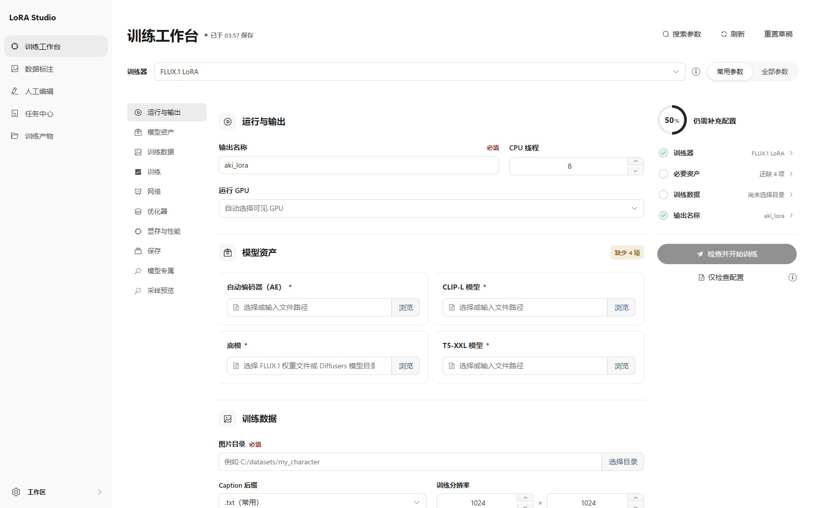
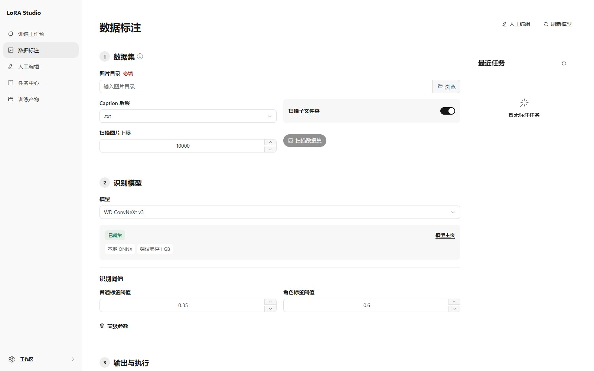

<div align="center">


# SD-Trainer

_✨ 享受 Stable Diffusion 训练！ ✨_

</div>

<p align="center">
  <a href="https://github.com/Akegarasu/lora-scripts" style="margin: 2px;">
    
  </a>
  <a href="https://github.com/Akegarasu/lora-scripts" style="margin: 2px;">
    
  </a>
  <a href="LICENSE" style="margin: 2px;">
    
  </a>
  <a href="https://github.com/Akegarasu/lora-scripts/releases" style="margin: 2px;">
    
  </a>
</p>

<p align="center">
  <a href="https://github.com/Akegarasu/lora-scripts/releases">下载</a>
  ·
  <a href="https://github.com/Akegarasu/lora-scripts/blob/main/README.md">文档</a>
  ·
  <a href="https://github.com/Akegarasu/lora-scripts/blob/main/README-zh.md">中文README</a>
</p>

LoRA-scripts（SD-Trainer）是基于 [kohya-ss/sd-scripts](https://github.com/kohya-ss/sd-scripts) 的本地训练与数据集工作台。v2 界面集成训练配置、Caption 生成、人工标签编辑、任务日志和训练指标。

## 训练工作台

选择训练器，配置模型资产和数据集，在启动任务前查看参数帮助与配置检查结果。表单随训练器展示对应参数，支持常用/全部参数切换、搜索和配置完成度检查。

当前目录提供 SD、SDXL、SD3、FLUX.1、Chroma、Lumina、HunyuanImage 2.1、Anima 和 MOSS-Image Base / SFT LoRA；实验性训练器会在界面中标注。训练代码直接收录于 `scripts/dev`，已同步 sd-scripts v0.12.3。MOSS-Image 的模型与依赖要求见[安装配置指南](docs/moss-image-training.md)。



任务保留配置、状态和日志，详情页直接展示损失与学习率曲线。指标读取兼容 TensorBoard 的事件文件，无需另外启动 TensorBoard 服务。

## Caption 与人工编辑

Caption 工作台可扫描数据集，使用 WD/CL 标签器、BLIP/GIT 系列模型及支持的 chat VLM 批量生成标签或自然语言描述。默认跳过已有 Caption，可选手动选图及写入前复核，并与训练任务共享 GPU 队列。界面会在执行前显示模型可用性与依赖要求。



独立的 Tag 编辑器支持逐图编辑、筛选、标签建议、批量增删、文本或正则替换以及格式整理。批量修改先预览再应用；备份与冲突检测支持在文件未被外部修改时安全回滚。

## Windows NVIDIA 便携版

从 [Releases](https://github.com/Akegarasu/lora-scripts/releases) 下载 `lora-scripts_windows_portable_nvidia.7z`，完整解压后双击包内的 `run_gui.bat`。

默认包包含 Python 3.11.9、PyTorch 2.14.1 / CUDA 13.0 和构建好的前端。另提供 `lora-scripts_windows_portable_nvidia_cu128.7z`，使用 PyTorch 2.11.0 / CUDA 12.8。两者均内置匹配的 ONNX GPU 运行时，需要 Windows x64 与兼容的 NVIDIA 驱动，无需另装 Python、Node.js 或 CUDA Toolkit。

默认 CUDA 13 包需要 R580 或更新驱动。cu128 包提供另一种 CUDA/驱动组合；两个包均要求 Turing 或更新架构，不恢复 Pascal、Volta 显卡支持。模型权重与训练数据需自行准备。详见[便携版选择与发布说明](docs/windows-portable.md)。

## 从源码安装

默认 CUDA 13.0 安装推荐使用已验证的 Python 3.11 x64；Python 3.10 源码安装须选择 cu128。获取源码需要 Git。构建前端还需要带 Corepack 的 Node.js 22 LTS（至少 22.12）或 24+，运行已构建的前端不需要 Node.js。

安装器默认提供 PyTorch 2.14.1、torchvision 0.29.1、xFormers 0.0.35 与 CUDA 13.0。Windows 传入 `-Cuda cu128`、Linux 传入 `--cuda cu128`，可选择 PyTorch 2.11.0 / torchvision 0.26.0。如需保留其他兼容组合，先在项目环境中安装对应的 PyTorch，再传入 `-SkipTorch` 或 `--skip-torch`；PyTorch 至少需要 2.6。启动时会按已安装 PyTorch 的 CUDA 版本选择 ONNX Runtime。

```sh
git clone https://github.com/Akegarasu/lora-scripts
cd lora-scripts
```

### 构建前端

当前开发版本在 `version.json` 中关闭了 `frontend.autoDownload`。源码首次启动前需要构建前端；前端代码更新后也需要重新构建：

```sh
cd frontend
corepack pnpm install --frozen-lockfile
corepack pnpm run build
cd ..
```

Corepack 使用 `frontend/package.json` 中固定的 pnpm 版本。构建结果与版本信息会写入 `frontend/dist`。

### Windows

在仓库根目录打开 PowerShell，执行：

```powershell
.\scripts\install-cn.ps1
.\scripts\run_gui.ps1
```

使用官方安装源时，将安装命令换成 `.\scripts\install.ps1`。
安装 CUDA 12.8 版本时使用 `.\scripts\install-cn.ps1 -Cuda cu128` 或 `.\scripts\install.ps1 -Cuda cu128`。

### Linux

在仓库根目录执行：

```sh
bash scripts/install.bash
source venv/bin/activate
bash scripts/run_gui.sh
```

GUI 启动脚本使用当前激活的 Python，因此每次新开终端都需要先激活 `venv`。启动后打开 [http://127.0.0.1:28000](http://127.0.0.1:28000)。
安装 CUDA 12.8 版本时使用 `bash scripts/install.bash --cuda cu128`。

更新 Python 依赖后，应重新运行安装器并重启 GUI。已启用前端自动下载的发布版本可以从 GitHub Release、Jihulab 或静态镜像获取匹配前端；开发版本仍需按上面的步骤构建。详见[前端版本与分发说明](docs/frontend-releases.md)。

### Docker

Dockerfile 会构建前端，并将当前源码与 PyTorch 2.14.1 / CUDA 13.0 一起打包：

```sh
docker build -t lora-scripts:local .
docker run --gpus all -p 28000:28000 lora-scripts:local
```

构建 CUDA 12.8 版本时需同时设置两个参数：

```sh
docker build --build-arg PYTORCH_IMAGE=pytorch/pytorch:2.11.0-cuda12.8-cudnn9-runtime --build-arg CUDA_FLAVOR=cu128 -t lora-scripts:cu128 .
```

宿主机需要兼容的 NVIDIA 驱动与 NVIDIA Container Toolkit。请把数据集、模型和输出目录挂载到容器内 `/app/lora-scripts` 下的对应位置，以便在容器外保留文件。

### 通过脚本训练

安装依赖后，也可在仓库根目录编辑并运行 Windows 的 `scripts/train.ps1` 或 Linux 的 `scripts/train.sh`。Linux 需要先激活 `venv`。这些入口与 GUI 使用同一份随仓库分发的训练代码。

## 发布

推送 `v*` tag、发布 Release，或手动运行 **Release frontend and Windows portable**，都会构建一次前端，并将同一制品用于前端 ZIP 和两个 Windows 便携包。手动运行使用所选分支在触发时的最新提交；填写的已有 Git tag 只指定上传目标 Release，工作流会在需要时创建该 Release。发布 tag 无需与 `version.json` 或 `frontend/package.json` 中的版本一致。

应用代码及其依赖配置始终取自同一源码提交。更新后可选择包含修改的分支手动运行，覆盖已有 Release 的附件，无需创建新 tag；推送 tag 和发布 Release 事件仍构建对应 tag 的源码。

完整流程见[前端版本准备](docs/frontend-releases.md)和 [Windows 打包与重试说明](docs/windows-portable.md)。

## GUI 参数

在已激活的环境中传给 `python gui.py`，或传给便携版的 `run_gui.bat`。

| 参数 | 默认值 | 说明 |
| --- | --- | --- |
| `--host` | `127.0.0.1` | 服务器绑定地址 |
| `--port` | `28000` | 服务器端口 |
| `--listen` | 关闭 | 监听所有网络接口 |
| `--skip-prepare-environment` | 关闭 | 跳过依赖检查与准备 |
| `--skip-prepare-onnxruntime` | 关闭 | 跳过 ONNX Runtime 准备 |
| `--disable-auto-mirror` | 关闭 | 禁用自动软件源镜像选择 |
| `--dev` | 关闭 | 启用后端自动重载，跳过前端自动下载 |
| `--frontend-source` | 读取配置，默认 `github` | `github`、`jihulab`/`cn`、`static`、`auto` 或 `off` |
| `--frontend-static-base-url` | 未设置 | 静态前端镜像根地址 |
| `--skip-frontend-download` | 关闭 | 跳过前端自动下载 |
| `--force-frontend-download` | 关闭 | 重新安装匹配版本的前端制品 |

## 许可

[GNU AGPL v3](LICENSE)。随仓库收录的组件与下载的模型分别遵循各自许可。
