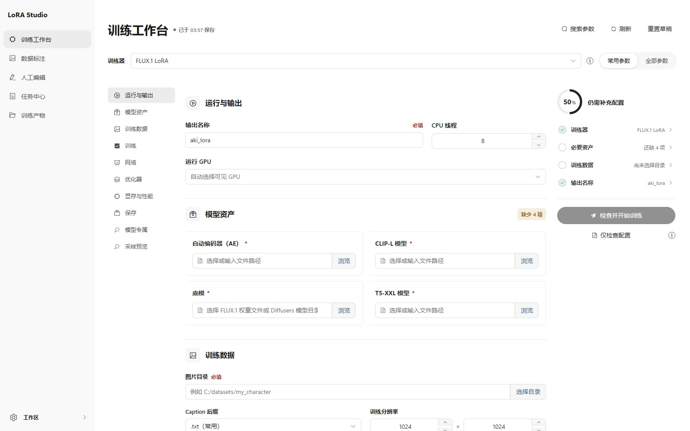
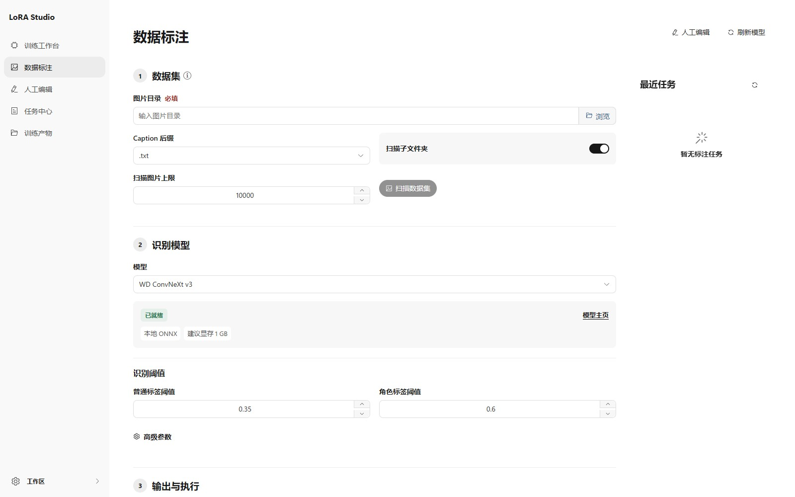

<div align="center">


# SD-Trainer

_✨ Enjoy Stable Diffusion Train！ ✨_

</div>

<p align="center">
  <a href="https://github.com/Akegarasu/lora-scripts" style="margin: 2px;">
    
  </a>
  <a href="https://github.com/Akegarasu/lora-scripts" style="margin: 2px;">
    
  </a>
  <a href="LICENSE" style="margin: 2px;">
    
  </a>
  <a href="https://github.com/Akegarasu/lora-scripts/releases" style="margin: 2px;">
    
  </a>
</p>

<p align="center">
  <a href="https://github.com/Akegarasu/lora-scripts/releases">Download</a>
  ·
  <a href="https://github.com/Akegarasu/lora-scripts/blob/main/README.md">Documents</a>
  ·
  <a href="https://github.com/Akegarasu/lora-scripts/blob/main/README-zh.md">中文README</a>
</p>

LoRA-scripts (SD-Trainer) is a local training and dataset workspace built on [kohya-ss/sd-scripts](https://github.com/kohya-ss/sd-scripts). The v2 interface brings training configuration, caption generation, manual tag editing, job logs and metrics into one application.

## Training workspace

Choose a trainer, configure model assets and datasets, and inspect parameter help and validation before starting a job. The form follows each trainer's supported parameters, with common and full parameter views, search, and a configuration checklist.

The current catalog includes SD, SDXL, SD3, FLUX.1, Chroma, Lumina, HunyuanImage 2.1, Anima and MOSS-Image Base / SFT LoRA. Experimental trainers are marked in the interface. Training code is vendored under `scripts/dev` and tracks sd-scripts v0.12.3; see the [MOSS-Image setup guide](docs/moss-image-training.md) for its model and dependency requirements.



Jobs retain their configuration, status and logs. Loss and learning-rate charts are displayed in job details using TensorBoard-compatible event files; the application does not need a separate TensorBoard server.

## Caption and Tag Editor

The Caption workspace scans datasets and generates tags or natural-language descriptions using WD/CL taggers, BLIP/GIT-family models and supported chat VLMs. It skips existing captions by default, supports optional image selection and review before writing, and shares the GPU queue with training. Model availability and dependency requirements are shown before execution.



The separate Tag Editor supports individual edits, filtering, tag suggestions, batch add/remove, text or regular-expression replacement, and normalization. Preview changes before applying them; backups and conflict checks support safe rollback when files have not been edited externally.

## Windows NVIDIA portable

Download `lora-scripts_windows_portable_nvidia.7z` from [Releases](https://github.com/Akegarasu/lora-scripts/releases), extract the complete archive, and double-click `run_gui.bat` inside it.

The default package includes Python 3.11.9, PyTorch 2.14.1 / CUDA 13.0 and the built frontend. A CUDA 12.8 fallback is available as `lora-scripts_windows_portable_nvidia_cu128.7z`, with PyTorch 2.11.0. Both include the matching ONNX GPU runtime and need Windows x64 plus a compatible NVIDIA driver; no separate Python, Node.js or CUDA Toolkit installation is required.

The default CUDA 13 package needs an R580 or newer driver. The cu128 package offers a different CUDA/driver combination; both packages require Turing or newer GPUs, so it does not restore Pascal or Volta support. Model weights and datasets are supplied separately. See [portable selection and release automation](docs/windows-portable.md).

## Install from source

Python 3.11 x64 is the recommended and tested version for the default CUDA 13.0 installation. Python 3.10 source installations must select the cu128 profile. Git is required for the source checkout. Building the frontend requires Node.js 22 LTS (at least 22.12) or 24+ with Corepack; Node.js is not needed to run a built frontend.

The default installer provides PyTorch 2.14.1, torchvision 0.29.1 and xFormers 0.0.35 for CUDA 13.0. Select `-Cuda cu128` on Windows or `--cuda cu128` on Linux for PyTorch 2.11.0 / torchvision 0.26.0. To keep another compatible PyTorch build, install it into the project environment first and pass `-SkipTorch` or `--skip-torch`; PyTorch must be at least 2.6. Startup selects ONNX Runtime to match the installed CUDA PyTorch build.

```sh
git clone https://github.com/Akegarasu/lora-scripts
cd lora-scripts
```

### Build the frontend

The current development version has `frontend.autoDownload` disabled in `version.json`. Build the frontend before starting a source checkout, and rebuild it after frontend changes:

```sh
cd frontend
corepack pnpm install --frozen-lockfile
corepack pnpm run build
cd ..
```

Corepack uses the pnpm version pinned in `frontend/package.json`. The build writes `frontend/dist` and its version metadata.

### Windows

Run from the repository root in PowerShell:

```powershell
.\scripts\install.ps1
.\scripts\run_gui.ps1
```

Use `.\scripts\install-cn.ps1` instead for the installation mirrors in mainland China.
For the CUDA 12.8 profile, use `.\scripts\install.ps1 -Cuda cu128` or `.\scripts\install-cn.ps1 -Cuda cu128`.

### Linux

Run from the repository root:

```sh
bash scripts/install.bash
source venv/bin/activate
bash scripts/run_gui.sh
```

The GUI shell script uses the active Python environment, so activate `venv` in each new terminal. Open [http://127.0.0.1:28000](http://127.0.0.1:28000) after startup.
Use `bash scripts/install.bash --cuda cu128` to install the CUDA 12.8 profile.

After updating Python dependencies, rerun the installer and restart the GUI. Released versions with frontend auto-download enabled can obtain their matching frontend from GitHub Release, Jihulab or a static mirror. Development checkouts still use the build steps above; see [frontend versioning and distribution](docs/frontend-releases.md).

### Docker

The Dockerfile builds the frontend and packages this checkout with PyTorch 2.14.1 / CUDA 13.0:

```sh
docker build -t lora-scripts:local .
docker run --gpus all -p 28000:28000 lora-scripts:local
```

To build the CUDA 12.8 variant, set both build arguments:

```sh
docker build --build-arg PYTORCH_IMAGE=pytorch/pytorch:2.11.0-cuda12.8-cudnn9-runtime --build-arg CUDA_FLAVOR=cu128 -t lora-scripts:cu128 .
```

The host needs a compatible NVIDIA driver and NVIDIA Container Toolkit. Mount datasets, model files and outputs into the corresponding directories under `/app/lora-scripts` to preserve them outside the container.

### Training scripts

For script-based training, edit and run `scripts/train.ps1` on Windows or `scripts/train.sh` on Linux from the repository root. Install dependencies first; on Linux, activate `venv` before running the script. These entrypoints use the same vendored training code as the GUI.

## Releases

Pushing a `v*` tag, publishing a Release, or manually running **Release frontend and Windows portable** builds the frontend once and uses that artifact for the frontend ZIP and both Windows portable packages. Manual runs build the selected branch's latest commit at dispatch time; the existing Git tag input only identifies the destination Release, which is created if needed. The release tag does not have to match the versions in `version.json` or `frontend/package.json`.

Application code and runtime dependency profiles always come from the same source commit. To replace an existing Release's assets with updated code, manually run the workflow from a branch containing the changes; no new tag is needed. Tag pushes and Release events still build the corresponding tag's source.

See [frontend release preparation](docs/frontend-releases.md) and [Windows packaging and retry instructions](docs/windows-portable.md) for the complete process.

## GUI arguments

Pass these to `python gui.py` in the active environment, or to the portable `run_gui.bat`.

| Argument | Default | Description |
| --- | --- | --- |
| `--host` | `127.0.0.1` | Server bind address |
| `--port` | `28000` | Server port |
| `--listen` | off | Listen on all network interfaces |
| `--skip-prepare-environment` | off | Skip dependency checks and preparation |
| `--skip-prepare-onnxruntime` | off | Skip ONNX Runtime preparation |
| `--disable-auto-mirror` | off | Disable automatic package mirror selection |
| `--dev` | off | Enable backend auto-reload and skip frontend auto-download |
| `--frontend-source` | configuration, then `github` | `github`, `jihulab`/`cn`, `static`, `auto`, or `off` |
| `--frontend-static-base-url` | unset | Base URL of a static frontend mirror |
| `--skip-frontend-download` | off | Skip frontend auto-download |
| `--force-frontend-download` | off | Reinstall the matching frontend artifact |

## License

[GNU AGPL v3](LICENSE). Vendored components and downloaded models retain their respective licenses.
